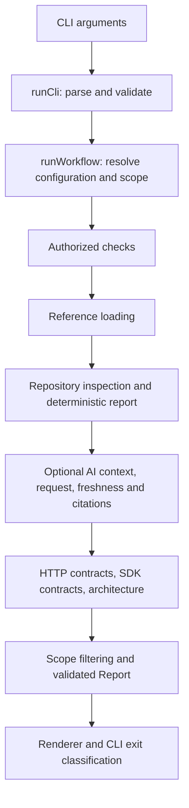

# Shipcheck: how the implementation works

Technical manual for the **2026-10-02 working tree**, package version **0.1.0**.

This manual explains the code that is present, including uncommitted changes. The checkout's baseline commit is `5581a74152dae3812fed1eb1ba4fc5352886ea75`; that commit alone does **not** identify the implementation described here. The [source manifest](technical-reference/source-manifest.json) records each runtime module's exact SHA-256.

The manual has two layers. This document explains how data moves through the application, how the algorithms work, and why their intermediate variables matter. The [complete module reference](technical-reference/README.md) follows every runtime module down to named functions, nested helpers, anonymous callbacks, parameters, variable declarations, type definitions, schema fields, control-flow branches, and complete numbered source listings. The reference's execution traces are derived from the source syntax; the explanations here and at the start of each chapter supply the product-level interpretation. Neither is a substitute for the other.

Coverage includes all application code under `src/`, including the evaluation APIs. Development scripts, compiler configuration, tests and fixtures are explained in the development section and [test catalogue](technical-reference/TESTS.md). Third-party parser internals, Node internals and generated `dist/` code are outside the application-source walkthrough. The source listings are included so a shortened expression in a reference table never hides its actual implementation.

## Contents

1. [What actually runs](#1-what-actually-runs)
2. [The language and data conventions](#2-the-language-and-data-conventions)
3. [CLI parsing and result delivery](#3-cli-parsing-and-result-delivery)
4. [Workflow orchestration and scope](#4-workflow-orchestration-and-scope)
5. [Configuration and ignore policies](#5-configuration-and-ignore-policies)
6. [Filesystem inspection and package facts](#6-filesystem-inspection-and-package-facts)
7. [Deterministic rules](#7-deterministic-rules)
8. [External checks](#8-external-checks)
9. [References and external access](#9-references-and-external-access)
10. [AI context and request construction](#10-ai-context-and-request-construction)
11. [AI response validation and evidence](#11-ai-response-validation-and-evidence)
12. [Task assessment](#12-task-assessment)
13. [Whole-repository batching](#13-whole-repository-batching)
14. [Live HTTP and durable spending](#14-live-http-and-durable-spending)
15. [HTTP contracts and language adapters](#15-http-contracts-and-language-adapters)
16. [Architecture checks](#16-architecture-checks)
17. [SDK declaration checks](#17-sdk-declaration-checks)
18. [Reports, exits and interpretation](#18-reports-exits-and-interpretation)
19. [Worked execution traces](#19-worked-execution-traces)
20. [Build, tests and development tooling](#20-build-tests-and-development-tooling)
21. [Navigating the complete source reference](#21-navigating-the-complete-source-reference)

## 1. What actually runs

Shipcheck is a Node.js command-line application and a library. It reads repository facts, evaluates deterministic rules, optionally runs explicitly authorized commands, optionally asks an AI reviewer for structured assessments, and compares selected source patterns with configured contracts and architecture policies. Its output is a report. It has no editing agent, database, HTTP server or user account system.

The package's `bin.shipcheck` points to `dist/src/cli.js`. During development, `tsx src/cli.ts` executes the TypeScript entry point. The package's `main` and `types` point to the compiled `index.js` and `index.d.ts`. Those are separate interfaces: an API consumer chooses which composition layer to invoke.



This diagram represents the integrated nonempty review workflow, not every command. Help/version and readiness shortcuts bypass inspection. An empty diff returns early. A required reference failure bypasses AI but still allows a deterministic report. Budget commands operate on allowance state rather than reviewing a repository.

Three API layers are particularly easy to confuse:

| API | What it actually does |
| --- | --- |
| `inspectRepository` | Reads the tree and returns facts, without evaluating policy findings. |
| `createReport` | Evaluates supplied facts with supplied/default configuration. No filesystem or network I/O. |
| `reviewRepository` | Loads or validates configuration, inspects, then calls `createReport`. |
| `reviewWithAi` | Performs deterministic review plus the selected AI stage. It does not itself run configured external checks or all contract stages. |
| `runWorkflow` | Integrates scope, tasks, checks, references, review, HTTP/SDK contracts, architecture and final report assembly. |

The [index module](technical-reference/index.md) re-exports APIs; exporting an API does not cause it to run. The [workflow chapter](technical-reference/workflows.md) is the best starting point for understanding the application as a whole.

## 2. The language and data conventions

The project uses strict TypeScript with ESM and NodeNext resolution. Source imports end in `.js` because those are the filenames Node will load after compilation. `import type`, interfaces, type aliases, `as`, non-null assertions (`!`) and `satisfies` guide the compiler but do not validate runtime values. Zod schemas and explicit `if` guards perform that validation.

`schema.parse(value)` returns the parsed value or throws. Object schemas can construct normalized objects and supply defaults; the implementation repeatedly uses parsing at stage boundaries rather than trusting a value merely because TypeScript assigns it a type. `safeParse` instead returns a success/error discriminated result. `.strict()` rejects unexpected object fields. Not every schema is strict: the provider envelope deliberately permits additional fields, and report schemas can strip unknown fields when parsed. This matters when writing forward-compatible consumers; the capture example validates but preserves the raw report object.

Important schema operators:

| Operator | Mechanism |
| --- | --- |
| `.optional()` | Allows an absent/undefined value. |
| `.nullable()` | Allows `null`, which is different from omission. |
| `.default(x)` | Supplies a default for undefined input. |
| `.prefault(x)` | Supplies input that still goes through the schema's parsing/default logic. |
| `.refine(predicate)` | Adds a boolean validation condition. |
| `.superRefine(callback)` | Allows multiple/custom issues, often with field paths. |
| `.transform(callback)` | Converts validated data to the returned shape. |
| `.extend` / `.safeExtend` | Builds an object schema with additional/overridden fields; `safeExtend` is used where existing refinements must be retained. |
| `z.infer` / `z.input` | Derives output/input TypeScript types from a schema. Neither executes a parser. |

Internal repository paths usually use relative forward slashes. Filesystem operations join them to a canonical absolute root. Native path functions handle the OS boundary; `posix` functions manipulate the portable internal representation. Line numbers in reports are one-based. Most text splitting recognizes CRLF, LF and CR, while particular syntax adapters reject unsupported line-ending combinations rather than misquote evidence.

Sets represent unique membership: inventory, visited paths, candidate IDs or already-detected bugs. Maps associate identities with mutable state: parser bindings, cached ignore readers, overload lists and deduplicated diagnostics. A `const` collection cannot be reassigned, but `.push`, `.set`, `.add`, property assignment and `.sort` still mutate its contents. A fresh object created with `{...old, field:newValue}` copies top-level properties, not every nested object.

Async functions return promises. An `await` pauses that function; it does not make an operation pure or atomic. `finally` blocks release handles and locks during both success and exceptions. Callback functions passed to `.map`, `.filter` and `.some` execute during those collection operations; callbacks registered with process streams execute later on events. The function reference distinguishes their containing scope and registration sites.

The same variable name has different meanings in different scopes. `result` might be a parsed schema value, a mutable report, an HTTP result or a process result. Use the function's parameter/local-binding section rather than assuming a global meaning. Common recurring names are:

| Name | Typical role |
| --- | --- |
| `root` | Canonical repository or authorized provider directory. |
| `target` | Caller-selected path before or during normalization. |
| `profile` | Captured inventory/facts, not a report. |
| `config` | Parsed/defaulted configuration. |
| `paths` / `scope` | A selected set/order of repository-relative paths; undefined commonly means unrestricted. |
| `record` | Serializable metadata/status for a resource. |
| `snapshot` | Metadata plus privately held content. |
| `context` | Source/reference/task material selected for one AI request. |
| `issues` / `warnings` | Reasons a stage could not fully interpret input. |
| `candidates` | Possible diagnoses, whose meaning depends on the stage; AI candidates never become deterministic findings here. |

## 3. CLI parsing and result delivery

The [executable](technical-reference/cli.md) calls `runCli(process.argv.slice(2))`. The slice removes the Node executable and script path. The returned `CliResult` contains `stdout`, `stderr` and `exitCode`. The executable prints nonempty strings to the corresponding stream and assigns `process.exitCode`; it does not forcibly terminate the process with `process.exit()`.

[runCli](technical-reference/cli-command.md) first examines `args[0]`. Budget/trial commands have separate exact-argument-count handlers. `help`, `--help`, `-h`, `--version` and `-v` return text without opening repository files. The removed `review` command produces a usage error. No arguments, `.`/`..`, or one explicit slash-containing path produce the historical readiness output. A bare arbitrary name is treated as an unknown command, so a real review uses `audit name`.

For `audit`, `diff` and `task`, the parser walks tokens with `index`. These are the state variables that determine interpretation:

| Variable | Initialization and changes |
| --- | --- |
| `target` | Starts undefined; first positional token sets it, a second is an error. |
| `literal` | Starts false; `--` sets true, disabling option interpretation for later tokens. |
| `json`, `markdown` | Set by output flags; both together are rejected after parsing. |
| `wantsHelp` | Records help request; after a successful token scan, returns help before cross-option validation. Invalid tokens encountered during scanning can still fail. |
| `ai` | Undefined or exactly `preview`, `mock`, `live`. |
| `mode` | Optional validated cost/quality selection; requires AI. |
| `trial`, `budget` | Explicit spending selection; mutually exclusive and usable only with live AI. |
| `runChecks` | Explicit command execution authorization. Configuration cannot set this runtime flag. |
| `wholeRepository` | Requests AI batching; workflow checks compatibility. |
| `referenceRoots` | Object mapping distinct validated grant IDs to caller-provided directories. |
| `referenceOrigins` | Array of exact HTTPS origins authorized for reference retrieval. |

Value-taking flags use `args[++index]`, consuming the next token immediately. The parser validates missing/invalid values rather than treating them as positional paths. Root grants split at the first `=` so the ID and path are separated. Duplicate root IDs and more than 16 grants are rejected. A leading `-` that is not recognized is an error unless `literal` is already true.

The live-authorization check compares `(ai === 'live')` with `Boolean(trial || budget)`. If they differ, either live has no spending authorization or authorization has been supplied for a non-live invocation; both fail. The default target is `process.cwd()`. Bare `task` additionally sets `currentTask:true`; an explicit target for task means a task file.

After `runWorkflow`, the CLI selects a renderer and independently computes the exit status. It can return a JSON report on stdout **and** a stage error explanation on stderr. A thrown configuration/root/usage error instead goes through `fail`, producing empty stdout, a prefixed stderr message and exit 2. Callers must not assume stdout always contains JSON merely because they supplied `--json`.

## 4. Workflow orchestration and scope

[runWorkflow](technical-reference/workflows.md) is ordered deliberately:

1. Reject incompatible workflow options.
2. Resolve inline `currentTask` or load an explicit task file; establish the review repository.
3. Normalize task expectations and define `reloadTask`, which will reread their source later.
4. Discover diff paths or deduplicate/sort task paths.
5. Return immediately for an empty diff.
6. Check selected path components for links and regular-file availability.
7. Resolve configuration, runtime reference access and AI batching mode.
8. If needed, inspect language inventory for check language gates; execute authorized checks.
9. Load applicable reference metadata.
10. Run deterministic review or the selected AI review composition.
11. Recheck task identity and assemble requirement summaries.
12. Run HTTP contracts, SDK contracts and architecture checks.
13. Filter deterministic findings for selected scope and validate the assembled report.

`inlineConfig` prevents an inline task from being selected from a different config instance during initial orchestration. `taskDefinition` is the normalized expectation object. `taskFile` distinguishes explicit-file reloading from config reloading. `reloadTask` also rejects an explicit task file whose repository changed; a hash comparison alone would not capture that because the normalized task hash does not include its repository field.

`paths` is undefined for ordinary audit, a sorted list for task, or the discovered current changed-path list for diff. `selected = new Set(paths)` supports final membership filtering. A deterministic finding survives when **any** evidence path belongs to that set. Rules run before filtering so they can consider full repository facts such as neighboring lockfiles. Consequently, filtering by only a finding's first evidence path would not be equivalent.

AI receives the selected paths before content collection, although it may add supporting local imports. Contract and SDK bindings intersect their explicit files with workflow scope. Architecture selection intersects its configured patterns with scope. External checks retain whole-repository scope in every workflow.

### How diff discovery works

`changedPaths` canonicalizes the target and asks Git for its top-level directory. A subdirectory cannot masquerade as the repository root. Its `git` helper uses `execFile`, no shell, a ten-second timeout, one-MiB output bound and hidden Windows window. Arguments disable optional locks, external diff and text conversion.

`git diff --name-only -z HEAD --` identifies tracked paths whose current working-tree state differs from HEAD. NUL separators preserve unusual filenames. This compares the current state with HEAD, not a historical patch stream and not necessarily the union of every staged/intermediate change. A staged change canceled by a working-tree edit can have no net HEAD difference.

The function obtains tracked inventory with `git ls-files --cached -z`, stores it in `indexed`, then walks local entries with a `pending` directory stack. Entries absent from `indexed` become untracked candidates. It does this locally instead of Git's `--exclude-standard`, which would apply global/info ignore settings and could hide files even when Shipcheck opts out of Git ignores.

`candidates` combines tracked changes and untracked entries. Deduplication, sorting and policy filtering produce `selected`. A config parse failure is held in `configError` while a default policy is used for discovery. It is rethrown when work is selected; when no paths remain, the no-work shortcut can still succeed. This is a narrow shortcut, not permission to ignore invalid configuration during a nonempty review.

Deleted/linked/non-regular diff selections are listed in `unavailablePaths`; the workflow cannot review their previous contents. A task selecting such a path is rejected. An empty diff skips checks, full content review and AI, but root validation, Git scope discovery and applicable ignore-policy work have already occurred.

### Snapshot timing

Authorized external programs can change files. They run before source/reference review snapshots, so generated or modified content can be reviewed. Configuration and task selection have already been loaded, however; later task identity checks disclose changes to expectations. The various later stages reread files independently. No stage freezes the entire repository, and source replacement races are not eliminated by `lstat` checks.

## 5. Configuration and ignore policies

[config.ts](technical-reference/config.md) validates `shipcheck.config.json`, defaults unspecified behavior and rejects unsupported fields. `loadConfig` validates the root first, uses `readBoundedConfig`, and defaults only when the config is absent. Malformed JSON or schema failure produces an invalid-config exception; read failures do not silently become defaults.

`ruleDefaults` is the authoritative severity table:

| Rule | Default |
| --- | --- |
| `package/invalid-json`, `package/invalid-object`, `package/invalid-scripts` | error |
| `package/conflicting-lockfiles` | warning |
| `package/missing-local-dependency` | error |
| `package/missing-script-target` | warning |
| `package/missing-entry-point`, `repository/missing-readme`, `repository/missing-tests`, `source/fixme` | off |

`rulesSchema` validates severity values and then rejects keys not present in `ruleDefaults`. `ruleLevel` starts with `config.rules[rule] ?? ruleDefaults[rule]`. It iterates overrides in declared order, replacing that level only if a file pattern matches and the override supplies that specific rule. Therefore the last applicable assignment wins; an unrelated later override does not reset the level.

`matchesPattern` splits patterns on `/`. A normal segment escapes regex punctuation and replaces `*` with `[^/]*`, so it cannot cross a slash. A middle `**` becomes zero or more whole `segment/` occurrences; a final `**` becomes `.*`. The whole expression is anchored. A separate condition lets `folder/**` match `folder` itself. `isExcluded` tests every path prefix, so excluding a parent excludes its descendants.

These explicit Shipcheck patterns are **not** the same language as `.gitignore`. Shipcheck config rejects backslashes, absolute/traversing/empty segments, question marks, braces and bracket classes. Repository `.gitignore` is parsed by the pinned `ignore` package and supports its richer Git pattern semantics.

### The subtle omitted-versus-empty distinction

The config transform computes:

```typescript
exclude: config.exclude ?? []
respectGitignore: config.respectGitignore ?? config.exclude === undefined
```

With no `exclude` field, Git ignore inheritance defaults to true. With `exclude: []`, it defaults to false. Supplying `respectGitignore` overrides either default. The normalized object stores that boolean, so parsing it again preserves the decision.

[createIgnorePolicy](technical-reference/ignore-policy.md) closes over:

| Binding | Purpose and mutation |
| --- | --- |
| `exclude` | Explicit patterns from options; tested before repository ignore files. |
| `enabled` | Whether repository `.gitignore` files participate. |
| `report` | Provenance plus skipped-entry counters/sample. |
| `cache` | Directory to promise of an ignore matcher, absence, or inaccessible-through-link sentinel. Reuses both successful and in-flight reads. |
| `bytesRead` | Aggregate successfully read ignore bytes. |
| `LIMIT`, `MAX_FILES` | 65,536 bytes per file and 256 recorded ignore sources. Aggregate bytes are capped at one MiB. |

Its nested `read` rejects linked, non-regular, oversized, binary and invalid UTF-8 ignore files. It opens a handle, reads at most limit plus one, closes in `finally`, hashes the raw bytes and creates a case-sensitive matcher. ENOENT means no file; other failures stop policy application.

`reason` checks `.git`/`node_modules` first when built-ins are enabled, then explicit exclusions, then applicable `.gitignore` scopes from root to parent. It tests each intermediate prefix. A matched parent is returned immediately, because a child cannot be reincluded while its parent remains ignored. Later scoped negation can undo an earlier match at the same reachable prefix. Global, ancestor and `.git/info/exclude` rules never participate.

`record` increments `skippedCount` and keeps at most 200 sample entries. One pruned directory is one recorded entry; its unenumerated descendants are not counted. `describe` returns sorted copies of the provenance/sample arrays. Different reading subsystems can create their own policy objects; the final ordinary inspection report is not a consolidated log of every policy read in every stage.

## 6. Filesystem inspection and package facts

[validateRoot](technical-reference/filesystem-policy.md) resolves an input to an absolute path, uses `lstat` to check the final entry is an unlinked directory, then returns `realpath`. Linked ancestors may resolve to the canonical root; an explicitly linked final root is rejected.

[inspectRepository](technical-reference/inspect-repository.md) parses ignore options and initializes a mutable `profile` with empty arrays/maps for files, directories, languages, manifests, README/test paths, package scripts/issues/references, markers and warnings. `warn` is a closure that appends `{path,code,message}`.

`pending = ['']` holds directories still to inspect; `''` represents the root. Each loop pops one directory and calls `readdir(...,{withFileTypes:true})`. Child enumeration failure adds a warning and continues. Root enumeration failure throws: a failed root read must not look like a valid empty repository. Entries are sorted by name, policy is checked before traversal, symlinks/special files are warned, directories are queued, and regular files enter `inspectFile`.

`classifyFile` lowercases the basename, looks up language by extension, detects known manifest names or .NET project extensions, tests README naming and checks test conventions. Classification occurs **before** content reading. Thus an oversized TypeScript test file still appears in inventory/language/test counts even when its content is skipped.

### The bounded read algorithm

Inside `inspectFile`, `handle` is opened read-only. A handle-level stat verifies a regular file and rejects an initial size above `MAX_FILE_BYTES = 1,048,576`. `buffer` has one extra byte. `length` tracks bytes actually read; each read fills the remaining capacity, advancing the file position. Zero bytes ends the loop. Reading the extra byte proves overflow, including a file that grew after stat. `bytes = buffer.subarray(0,length)` retains only actual input. The handle closes regardless of success.

NUL bytes or fatal UTF-8 decoding failure yield `non-text-file`. A BOM is accepted by the decoder. Read/type/size warnings do not undo the earlier classification. Ordinary inspection has a per-file cap, not a total tree-byte/file-count cap.

Only a basename exactly equal to `package.json` triggers JSON content inspection. The classifier lowercases names, but this content check is case-sensitive; the implementation does not promise every manifest-like casing is parsed. `packageReferences` and `inspectPackage` independently decode its text for different purposes.

`inspectPackage` first catches JSON syntax errors, then rejects null/arrays/primitives, then validates optional scripts as a record of strings. It sorts valid script names into a fresh object. It does not validate every npm field or execute any script. A typed issue and an `invalid-manifest` warning are both captured; reporting later handles duplication.

`packageReferences` extracts:

- `file:` targets from dependencies, devDependencies and optionalDependencies.
- Scripts exactly matching a narrow `node path.js` / `tsx path.ts` shape, with selected related extensions and no general shell parsing.
- String `main`, `module`, `types`, `typings`, and string/object `bin` targets.

Every readable text file is split into lines and scanned with `\b(TODO|FIXME)\b`. Each occurrence produces a marker with the exact whole-line excerpt and one-based index. A line with two markers can produce two observations. Documentation and string literals participate; this is not comment parsing.

### Existence is a three-way fact

[referenceExistence](technical-reference/reference-existence.md) joins each target to its manifest directory, normalizes it, and rejects protocols, expansion syntax, absolute/outside-root locations or exclusions as `unknown`. It walks path components with native filesystem case behavior. Canonical relative paths are checked against exclusions too, preventing a differently cased spelling from bypassing the policy.

`exists` requires completing the walk through ordinary entries. `missing` requires ENOENT and a nonignored target. Links, special files, inaccessible components and uncertain paths produce `unknown`. The later missing-target rule requires the explicit `missing` fact; it cannot infer absence simply because a path was not inventoried.

Finally, inspection sorts its collections, sorts language keys, attaches `policy.describe()`, and parses `repositoryProfileSchema`. With an unchanged readable tree, this makes output stable despite traversal order. It does not guarantee determinism when the tree changes concurrently.

## 7. Deterministic rules

[createReport](technical-reference/findings.md) is pure with respect to the external world: it operates on parsed/captured facts. `config` supplies levels, `profile` is a validated copy, and `candidates` combines package-issue conversions with `additionalFindings`.

For a package issue, `rules[issue.code]` selects title/explanation/action. The ID combines rule ID and URL-encoded path. Evidence contains the captured path and observation; no parser line number is invented. Additional-rule IDs also include an encoded key, such as a manifest field or marker line, to distinguish multiple findings at one path.

Each candidate is excluded or assigned the final rule severity based on its first evidence path. An `off` result disappears. Remaining findings sort by ID. `diagnosedPaths` contains every typed package issue path; an `invalid-manifest` warning at one of those paths is removed. Because that set is built from issues rather than emitted findings, disabling a detailed package rule also removes the duplicate warning. Other warnings remain, including legacy invalid-manifest warnings without typed issues.

[additionalFindings](technical-reference/additional-rules.md) uses `files` and `directories` sets to avoid repeated linear searches. Its local `add` builds consistent finding shape with provisional warning severity; `createReport` assigns the actual policy severity later.

Lockfile evaluation iterates inventoried package manifests, gathers lockfiles in the same directory, maps them to managers and counts distinct managers. `package-lock.json` and `npm-shrinkwrap.json` both map to npm, so their coexistence is not a cross-manager conflict. Different package directories are considered independently. Lockfile evidence supplements the manifest evidence.

Missing-reference evaluation requires `existence === 'missing'`, an included owning manifest and a supported safe target shape. It also avoids excluded paths, known files/directories and paths under unreadable/linked/special entries. Non-bin extensionless entry points are skipped because generic resolution would be ambiguous. The rule ID depends on dependency/script/entry kind.

Missing README/test candidates are produced only when relevant inventory is not known to be incomplete. They are still off by default. Their meaning is filename-convention absence among inspected paths, not absence of all documentation or actual test coverage.

The FIXME policy requires a `src/` path, selected source extension, a non-test file, and a line beginning with a supported comment delimiter followed by FIXME. `seen` deduplicates path/line pairs. It is still a regex heuristic; a multiline string can resemble a comment. Generic TODO/FIXME counts never become findings automatically.

## 8. External checks

[checkSchema](technical-reference/checks.md) constrains command/arguments, timeout, combined output size, diagnostic format, failure exit codes and optional language gate. It rejects recognized `--fix`, `--fix-only`, `--unsafe-fixes` and `--write` flags. This is a guard against common accidental fixing options, not a proof that an arbitrary executable is read-only.

`runChecks` processes checks sequentially. `authorized:false` yields skipped results. A language gate compares configured language names against the exclusion-aware inventory prepared by the workflow; absent matching language skips the check. Neither condition authorizes execution by itself.

For an executed check, a promise wraps `spawn(command,args,{cwd:root,shell:false,...})`. Arguments are passed literally without shell expansion. The child is detached on POSIX so its process group can be terminated, and hidden on Windows. Standard input is ignored; stdout and stderr are pipes.

The environment copy removes the configured credential variable and names matching KEY/TOKEN/SECRET/PASSWORD. Their original values are retained in `secrets` for output redaction. This does not stop a program reading credentials from other files or using other network/process capabilities.

| Local state | How it controls execution |
| --- | --- |
| `chunks` | Shared arrival-order output for the human-readable combined log. |
| `stdoutChunks`, `stderrChunks` | Preserve independent streams; only stdout is parsed as structured diagnostics. |
| `bytes` | Counts all received bytes from both streams, including the overflow chunk. |
| `finished` | Makes promise completion idempotent. |
| `stopping` | Prevents stream/close events racing with timeout/overflow cleanup. |
| `timer` | Schedules bounded runtime and is cleared by `finish`. |

`capture` computes remaining space, stores only that prefix of a chunk, then checks whether actual received bytes exceeded the cap. `stop` destroys streams, unreferences the child and awaits best-effort process-tree termination before producing an error. `finish` concatenates and redacts output, optionally parses diagnostics, then resolves a result.

For text checks, exit 0 passes, configured `failureExitCodes` fail, and other exits/signals/launch failures are operational errors. Structured output is parsed only if the initial status is not an operational error. For structured checks, threshold violations fail; a nonzero exit with no diagnostics also fails. Otherwise diagnostic policy can convert a recognized failure exit into a pass when diagnostics are below threshold. `failOn:'never'` suppresses severity-triggered failure, not every possible command failure.

[parseDiagnostics](technical-reference/check-diagnostics.md) validates JSON shapes, removes ESLint severity 0, maps severity 2 to error and 1 to warning, and maps Ruff diagnostics to error. `sourcePath` resolves a reported location relative to root and rejects escapes; it does not read the file or verify a reported line. IDs hash normalized diagnostics with their check ID, a Map deduplicates them, and sorting stabilizes results. `exceedsThreshold` uses ranks error=3, warning=2, info=1, never=4.

[terminateCheckTree](technical-reference/check-process.md) uses the system Windows taskkill executable with `/PID ... /T /F`, or `process.kill(-pid,'SIGKILL')` for a POSIX group. Failure falls back to the direct child and returns false. A deliberately detached descendant is outside this best-effort containment model.

## 9. References and external access

References have three representations:

| Representation | Contents |
| --- | --- |
| Definition | Configured ID/path/kind/authority/version/pin/scope/required flag. |
| Record | Definition plus load status, byte hash, counts and optional origin. Safe to include as report metadata. |
| Snapshot | Record plus decoded text, held in memory for comparison or AI context. |

[loadReferenceResources](technical-reference/reference-resources.md) parses config and runtime access grants, then processes resources in declaration order. `consumed` tracks bytes read under the 262,144-byte aggregate limit; each file is capped at 65,536 bytes. Applicability compares workflow/source paths with resource `appliesTo` patterns. Inapplicable resources are recorded but not read.

Explicit exclusions and intrinsic `.git`/`.env` filtering run before access. Sensitive filename heuristics can reject a path before reading. Local reads walk components, reject links, compare canonical paths against exclusions, and use the same limit-plus-one/fatal-UTF-8 pattern as other bounded readers. Source resources used by contracts are subject to these reference-size caps, not the ordinary inspection one-MiB cap.

An external `rootId` must resolve in runtime `grants.roots`. Its validated canonical root is hashed into origin metadata. A URL must have an exact allowed origin and an expected SHA-256 pin. External citation paths become `@references/<id>/<path>` so they cannot collide accidentally with ordinary repository paths by merely sharing a filename.

Successful raw bytes are hashed before interpretation. `consumed` advances even if the resulting content is subsequently rejected as sensitive or fails its pin. Record hash/count fields are set before a hash mismatch is recorded, allowing the mismatch to be reported without retaining a usable snapshot. A required applicable resource that is not loaded makes `references.state = 'incomplete'`; optional failures remain visible without blocking the whole loading state. `evaluation:'not-assessed'` means loading alone has not evaluated expectations.

[readRemoteReference](technical-reference/remote-reference.md) performs the actual HTTPS read:

1. Parse the constrained URL and reject literal IP hostnames.
2. Create one ten-second deadline spanning DNS and response.
3. Resolve all DNS answers and reject the set if any address fails `publicReferenceAddress`.
4. Pin the request's lookup callback to the first accepted answer.
5. Request identity encoding with no cookies/authentication and no reusable agent.
6. Reject non-200 status and nonidentity content encoding; redirects are not followed.
7. Accumulate chunks only within the caller's byte limit; reject read/abort/overflow errors.

The IPv4/IPv6 blocklists and IPv6 global-unicast condition are explicit code policy, not an unrestricted DNS-to-internal-network fetch. Configuration cannot replace the network implementation with repository code. Preview/mock modes avoid model requests but can still fetch an explicitly authorized HTTPS reference.

`verifyResourceEvidence` requires a valid evidence shape, a submitted loaded resource with the cited ID/hash, a fresh loaded resource, unchanged content/hash/path/version/authority/origin, and an exact complete-line excerpt. Matching verifies provenance, not whether the reference is true or authoritative in reality; authority/version labels remain configured assertions.

## 10. AI context and request construction

[reviewWithAi](technical-reference/ai--review.md) first validates execution/spending combinations and creates a deterministic report. The separate mutable AI `result` begins with empty preview/candidates, zero retries, null estimated price, and execution-specific cost metadata. The AI preparation/request/verification portion is caught so a failure can be attached while the deterministic findings survive. Configuration or initial inspection failures before that block still reject the call.

`plannedModel` chooses config mapping or the live allowance mapping. Synthetic mock `model` becomes `mock-<mode>`. An injected client used through the offline seam is labeled `injected`; it requires a configured planned model and cannot be used as the live path. Preview may display no selected model because it is not making a request.

Task JSON bytes, if any, are reserved before collecting source. Sensitive task text and tasks leaving insufficient context space fail before request dispatch. `sourceSettings` reduces `maxContextBytes` by task bytes, preserving the overall context accounting decision.

### Source selection

[collectContext](technical-reference/ai--context.md) starts with canonical root, a fresh ignore policy, `files=[]`, a preview, an inventory Set, requested order and visited Set. Without explicit paths, it sorts source under `src/` first, then `test/` or `tests/`, then other files. Explicit path order is retained to keep a batch's unreviewed seed from being displaced by old supporting imports.

`allowed` rejects hidden segments, sensitive names, generated/vendor directories, unsafe path syntax and unsupported extensions. `readSource` walks components with `lstat` and `realpath`, rechecks exclusions and links, applies the configured file cap and decodes complete UTF-8 text. Content matching the sensitive regex is rejected; empty content is skipped.

For each candidate `next={path,content}`, the collector measures `Buffer.byteLength(JSON.stringify([...files,next]))`. A file that would exceed the serialized-context cap is omitted whole; it is not truncated. Accepted metadata includes byte count, line count and a hash of decoded content. This source hash differs conceptually from a reference's raw-byte hash, especially for BOM handling.

`localImports` finds narrow lexical relative import/export hints. `resolveLocalImport` joins them to the importing directory and tries a fixed list of inventory paths/extensions. Supporting paths are spliced immediately after their importer. `visited` prevents cycles/repeated reads. After collection, dependency status becomes included when its resolved path is present; otherwise omitted/unresolved. Missing dependency context sets `limited`.

This lexical helper is used even though richer parsers exist elsewhere. It is only a context hint, not the architecture dependency extractor and not a general module resolver. It can return the first matching extension candidate rather than prove compiler resolution.

Default limits in [ai/contracts.ts](technical-reference/ai--contracts.md) are 12 files, 16,000 bytes per file, 48,000 serialized context bytes, 1,000 output tokens, 10-second timeout and 20 whole-repository batches. Configured maxima are separate from live-spending maxima. The context size is not the complete HTTP request size because numbered-line formatting, prompts and output schema add overhead.

### Reference attachment and request shape

[attachReferences](technical-reference/ai--reference-context.md) loads references for selected source paths, initializes `context.references`, and attempts to add each entire snapshot. It detects duplicate citation paths and collisions with source paths. It measures serialized files plus snapshots against the remaining context allowance. Optional failure marks limited coverage; required failure returns `blocked`, causing the review to fail before a model call.

[buildRequest](technical-reference/ai--client.md) selects a base candidate schema, requires a conflict array whenever reference context exists, and adds task assessments when a task exists. Zod converts that into JSON Schema; the `$schema` dialect field is removed from the object sent as the response format.

The request sets `store:false`, the chosen model, output-token limit, reviewer instructions and a single user content string containing JSON. Each source/reference becomes `numberedLines: [{line:1,text:...}, ...]`. Source and reference content are data inside that payload, not concatenated into the reviewer instructions. `focusPaths` identifies intended scope, and `missingDependencies` names unprovided context. No tools are offered to the reviewer.

`requestBytes` measures the full serialized request. `estimatedInputTokens = ceil(requestBytes/3)` is only a heuristic. Live execution separately obtains a provider token count before generation. Preview stops after preparation/accounting; it does not claim a valid model response.

## 11. AI response validation and evidence

[requestQa](technical-reference/ai--client.md) is the transport-injection layer used for offline/mock tests. It requires a nonblank credential string, creates an AbortController, races transport against a timer, classifies HTTP errors and decodes a successful body. Unknown transport errors become a sanitized message so provider details cannot leak credentials or source. There are no retries.

`decodeResponse` enforces a 131,072-byte body cap before parsing. The outer envelope must have `status:'completed'`; incomplete/refusal responses are errors, not partially accepted candidates. Exactly one `output_text` part among message content must contain the structured JSON. Strict candidate/reference/task schemas reject extra action-like fields as well as malformed data.

Every cited path and line range must belong to supplied source/reference context. A conflict must cite at least two distinct supplied reference paths. A task response must contain exactly one assessment for each supplied requirement ID, no invented IDs and only known related IDs. Supporting/violating task claims must cite selected task source, not merely a reference or supporting file.

These are structural checks. After decoding, the review recollects the submitted source through the same eligibility/bounded-read policy. Every submitted file is checked for unchanged content, even when the model returns no candidates. A no-candidate response can therefore still have partial coverage if the source changed. References are reloaded and compared too.

[verifyEvidence](technical-reference/ai--verify-evidence.md) maps each citation to a check:

- Missing submitted source: rejected as not in submitted context.
- Missing fresh source: rejected as unavailable.
- Any whole-file content change: rejected as source-changed, even if the cited lines happen to remain identical.
- Invalid one-based range: rejected.
- Exact range text differing from the excerpt, after newline normalization: rejected.
- Otherwise: matched.

All checks must match and there must be at least one citation. Reference citations delegate to `verifyResourceEvidence`. The comparison preserves whitespace; it does not use fuzzy search to rescue an approximate quote.

`reviewWithAi` retains only candidates with at least one source citation affecting requested scope. Reference-only or out-of-scope candidates contribute to an out-of-scope count. Retained candidates receive a SHA-256-derived ID and `origin:'ai'`. Their `evidenceStatus` remains **unverified** even when `evidenceVerification.status` is **matched**: the latter says the quote is real, not that the explanation is correct.

Reference conflicts get separate IDs, verified citations and `needs-clarification`. Paths cited by conflicts mark dependent candidates as `referenceConflict:true`. Coverage becomes partial when conflicts are present; the program does not resolve contradictory expectations by choosing the higher declared authority.

Final coverage reports selected paths, valid/failed response paths, skipped paths and matched/rejected/out-of-scope candidate counts. A completed response can be partial because of omitted content, changed snapshots, rejected evidence, uncertain task assessment or conflicts. `validResponsePaths` means a structurally valid response covered supplied context, not that every path was independently proven correct.

`mockTransport` selects the first nonempty line of the first file and creates an explicitly synthetic informational candidate. The excerpt is capped at 4,000 characters; an extremely long line can therefore fail exact-line verification. Mock tasks receive insufficient-evidence outcomes. Mock operation checks integration plumbing, not defect-finding quality.

## 12. Task assessment

[task-file.ts](technical-reference/task-file.md) supports two inputs. Legacy JSON contains `version`, `repository`, `files` and string `criteria`; `normalizeLegacyTask` turns those criteria into `criterion-1`, `criterion-2`, etc. Inline `currentTask` contains stable task/requirement IDs, title, description, files and nonGoals. Both are bounded and strict.

`describeCurrentTask` parses the definition, serializes the normalized object and hashes it. Defaults/trimmed fields participate in that normalized identity; list order remains meaningful. The hash identifies expectations but does not prove user approval or preserve the old intent if both code and expectations are edited.

[pendingTaskReview](technical-reference/ai--task-review.md) creates a result for every requirement before any assessment, all insufficient-evidence. `finishTaskReview` then iterates the original requirement order, finds the corresponding decoded model item, and keeps its original `proposedStatus` while deriving the effective status.

The downgrade order is significant. Rejected citations or synthetic execution become insufficient-evidence first. Otherwise a disputed cited reference becomes needs-clarification. Otherwise supporting-evidence becomes insufficient-evidence when selected task files are missing/changed, dependency context is incomplete, or applicable references are omitted/stale. The function does not upgrade uncertainty just because no defect was found.

Overall state is not-assessed for mock; otherwise partial if any requirement is uncertain/needs clarification, or assessed if all are substantive. Assessed still means evidence-based interpretation, not proof of completion.

The AI reviewer reloads task expectations and compares their hash. Without a successful unchanged reload, `invalidateTaskReview` sets state/freshness to changed and every effective status to insufficient-evidence, prefixing an explanation while preserving proposedStatus. Workflow orchestration performs an additional identity check before final assembly. These checks also expose expectation mutations by authorized external programs.

`currentTask` is the compact report summary; `ai.taskReview` holds detailed explanations, proposed/effective statuses and citations. Neither supporting-evidence nor potential-violation independently determines the CLI exit code.

## 13. Whole-repository batching

[reviewWholeRepository](technical-reference/ai--whole-repository.md) requires unrestricted audit-style source selection; it rejects task definitions and explicit paths. Live batching needs a named budget, not the legacy trial.

It inspects once for initial inventory and deterministic findings, then maintains:

| Binding | Meaning |
| --- | --- |
| `remaining` | Inventory paths not yet processed or permanently skipped. |
| `selected` | Paths actually included in batch preview contexts. |
| `valid` | Paths associated with completed valid batch responses. |
| `skipped` | Path-to-reason Map for permanent or final omissions. |
| `batches` | Independent AI results retained in execution order. |
| `stoppedReason` | First failed batch's error code. |

Each iteration calls `collectContext` with remaining paths. Permanent skips are removed; file-count/context-size skips remain available for later batches. If nothing fits, remaining paths become cannot-fit-context and the loop ends. Otherwise `reviewWithAi` performs the batch, including its own inspection/selection; the planner's context is not directly reused as the submitted snapshot.

That reread can change selection, so planner paths absent from actual preview are marked unavailable-during-batch. Actual selected/supporting files are removed from remaining and clear stale skip entries. Valid-response paths accumulate separately. On a failed batch, earlier batches survive and later work is labeled stopped. Reaching `maxBatches` labels remaining paths batch-count-limit.

Aggregate state is failed if any batch failed; otherwise preview for preview execution; otherwise partial if skipped paths or partial batches exist; otherwise complete. Initial inventory can include non-source files, so skipped non-source entries can contribute to partial coverage. Whole-repository means attempted batching over eligible context, not guaranteed full-program understanding.

## 14. Live HTTP and durable spending

[live.ts](technical-reference/ai--live.md) fixes production requests to the Responses endpoint named in the source. Its `post` helper sends JSON with bearer authentication, disables redirects, races an aborting timeout against the whole response read, and rejects bodies over 128 KiB. It cancels unsuccessful response bodies, releases stream-reader locks and clears timers. The program performs no retry.

`requestLiveQa` and `requestBudgetQa` validate credentials, exact approved model mapping and output limits **before** reserving. They add low reasoning effort and the default service tier, hash the exact payload, and execute inside a durable reservation callback. The callback first requests input token counting with the same relevant model/input/instructions/schema/reasoning, then generates only if the count is within the allowance limit.

Trial input is capped at 5,000 tokens; named-budget input at 32,000. Both live output paths cap at 2,000 even though general AI config allows 4,096. Usage and tier are validated before accepting decoded output. The named-budget path also verifies reported output tokens do not exceed this request's limit. The two POSTs each use the configured timeout, so that value is not a single cap on the entire two-request sequence plus preparation.

### Why microdollars and reservations exist

[audit-budget.ts](technical-reference/ai--audit-budget.md) stores integer microdollars: one dollar equals one million units. A price expressed as dollars per million tokens has the same numeric value as microdollars per token. Usage is `ceil(inputTokens*inputRate + outputTokens*outputRate)`. Reservation is `ceil(worstCaseUsage*1.25)` using policy token maxima, not the exact request's smaller output setting.

The model/rate tables and date windows are **the values pinned in this source snapshot**, not a claim about current external API pricing. Version-2 named policy starts 2026-09-30 and expires 2026-10-30 UTC. Legacy trial expires 2026-10-03 UTC. The code stops spending outside its policy window rather than silently fetching or trusting new prices.

Named budgets live under the user's home `.shipcheck/budgets/<name>`. A name is validated and cannot be a reserved Windows device name. `parseAllowanceUsd` accepts a bounded decimal amount from $0.01 to $100.00, converts to cents, and returns dollars; the policy stores integer microdollars in cent increments.

`initializeBudget` creates a new directory and `policy.json`; it refuses to overwrite/reset an existing allowance. `writeExclusive` opens with `wx`, writes JSON, synchronizes the handle, then closes it. `readJson` rejects links/non-files/oversized state and reads at most 8,193 bytes for an 8,192-byte limit.

`budgetStatus` reconstructs state rather than trusting a mutable balance field. It validates parent directories and policy, allows only known filenames, requires sequential six-digit attempts, rejects orphan receipts/settlements, checks mode/model/reservation against policy-version prices, validates receipt arithmetic and sums **all reservations**. Remaining allowance is original allowance minus reservations, not original allowance minus measured usage.

### The reservation transaction

`withAuditReservation` reads status, rejects locks/unresolved attempts/expiry, creates the lock exclusively, then rereads status while holding it. It requires current policy version and enough remaining allowance. It writes `<id>.attempt.json` with mode/model/reservation/request hash **before invoking either network operation**. Successful execution yields validated usage and an immutable receipt; the full reservation remains spent. Finally it closes/removes the lock.

An exception after attempt creation leaves an unresolved attempt. A hard process kill can also leave the lock itself. Later spending is blocked rather than assuming no charge occurred. `settleBudgetAttempt` uses its own lock and writes a full-reservation settlement for an unresolved attempt; it does not refund money or fabricate token usage. It cannot simply bypass an existing stale lock. An existing valid settlement is idempotent.

[trial-budget.ts](technical-reference/ai--trial-budget.md) follows a smaller legacy policy: $0.50, three requests total, one attempt per mode, mode-named files and no automatic reset. Its read helper performs one bounded read rather than the newer looped reader. The trial state must match the shipped policy exactly. Its failures/reservations remain durable too.

The report's priced usage upper bound is accounting under those pinned rates, not an invoice. `actualCostUsd` for live/injected review is not replaced with a guessed bill; allowance metadata carries reservations and priced usage separately.

## 15. HTTP contracts and language adapters

[auditContracts](technical-reference/contract-audit.md) iterates configured bindings. `files` deduplicates explicit consumer files and intersects workflow scope. Each `result` starts checked with empty file/call/issue arrays. The binding must identify an OpenAPI resource applicable to every selected file. Provider loading, indexing and version validation happen before consumer extraction.

[indexOpenApi](technical-reference/openapi-contract.md) parses only JSON OpenAPI 3.0.x/3.1.x. It requires basic info/title/version/paths shapes, then iterates sorted path names and a fixed method list. It does not resolve `$ref`, validate every schema or index webhooks. Issues make the index partial; the integrated contract audit requires a fully indexed result before comparing. An issue elsewhere in the provider can therefore block comparison instead of quietly using a fragment.

Operation evidence uses JSON Pointers. `pointer` replaces `~` with `~0` and `/` with `~1`, preserving exact object-key identity. `versionIssue` checks resource-declared version, exact expected version and optional semver range in that order.

Consumers load as bounded source resources, then [contractAdapterFor](technical-reference/contract-adapters.md) selects a bundled extractor by extension. No adapter/failed read/no supported calls/parser issues all produce explicit incomplete coverage. A zero-call file is not a clean contract assessment.

### How one call is compared

The private `compare` function performs these decisions in order:

1. If extraction already supplied `call.reason`, return unresolved.
2. Parse the URL without a base; relative/dynamic URLs remain unresolved.
3. Reject credential-bearing URLs. Compare origin and path prefix with `baseUrl`; outside-service is separate from a contract defect.
4. Accept only the comparison method whitelist. Encoded route paths are unresolved.
5. Prefer an exact route key; otherwise compare slash segments, allowing only a full `{name}` segment to match a nonempty segment.
6. Reject unsupported provider template shapes or ambiguous multiple matches. No match is a route mismatch.
7. Check that the selected method exists as an operation object; absence is a method mismatch.
8. Build a parameter Map keyed by `in:name`, first from path-level then operation-level parameters, so operation definitions override the same key.
9. Reject references, duplicate parameters at one level, malformed definitions and unsupported required-query serialization.
10. For each required primitive form query parameter, check URL search parameters or adapter-extracted `queryNames`. Missing names are mismatches; otherwise return matched.

It does not compare parameter values, path parameter types, request bodies, responses or authentication. `matched` describes exactly that narrow comparison. The OpenAPI index recognizes TRACE, but the call comparison whitelist does not; indexing a method does not imply all adapters/comparisons support it.

### JS/TS fetch and Axios

[parseHttpSyntax](technical-reference/fetch-calls.md) uses Acorn for JS and Babel with ESTree/TypeScript (plus JSX for TSX) for typed syntax. It flattens the syntax tree into `{node,parent}` entries with an iterative stack. Parser failure or Unicode line separators yields issues without inference.

`extractFetchCalls` first asks whether any `fetch` identifier use is not a direct callee, or eval/with makes bindings uncertain. This conservative file-wide check prevents shadowed functions from being assumed to be global fetch. Direct calls then require one or two arguments, a string literal URL and optional plain literal options. Method must be a supported literal property shape; spreads/computed/method/getter properties are unresolved. Type-only wrappers are removed by `unwrap`.

[extractAxiosCalls](technical-reference/axios-calls.md) establishes a default Axios import and tracks alias uses. Unexpected identifier/configuration uses make the alias ambiguous. Its `properties` helper accepts plain object properties and records their final value in a Map. It distinguishes `axios(config)`, `axios.request(config)`, `axios(url,config)`, verb helpers, and body-taking post/put/patch argument positions. Only a fixed option set is supported. Literal scalar `params` contribute query names; null values are omitted. Configured instances/interceptors/base URL behavior are not generally inferred.

`extractJavascriptHttpCalls` independently runs both extractors, merges by source line and caps the combined list at 128. Thus the shared cap does not allow 128 fetch plus another 128 Axios observations to escape the per-file limit.

### Python Requests and HTTPX

[extractPythonCalls](technical-reference/python-calls.md) uses Lezer syntax nodes entirely in Node. `children` drops comments; `same` compares node ranges and names; `text` slices source. The literal helper only accepts simple unescaped single/double quoted strings, rejecting prefixes, concatenation, multiline forms and escapes rather than evaluating Python.

`imports` establishes simple top-level module imports. `aliases` and `ambiguous` track unexpected namespace uses or namespace-mutating builtins. `sessions` recognizes fresh zero-argument Requests Session/HTTPX Client creations in simple assignments or supported with-statements. A session must remain valid, be used after creation and have the same recognized scope. Other identifier uses invalidate inference.

Call argument nodes are divided at commas into groups. The extractor maps positional arguments to the client/method-specific parameter names, gathers unique keywords and rejects dynamic/unsupported groups. Literal URL/method values and supported keyword sets are checked before query dictionaries. Scalar dictionary values establish query-name presence; Requests `None` deletes a key while HTTPX `None` retains it in this model. Bodies/authentication may be accepted as syntactic options without being assessed by contract comparison.

### Go, C# and Java

[standard-http-syntax.ts](technical-reference/standard-http-syntax.md) lazily initializes the fixed ast-grep runtime and packaged grammars on first use. Repository-selected parser code is never loaded. It rejects recovery/error nodes and problematic line endings. `observation` preserves complete-line excerpts with a 128-call cap and 2,048-character excerpt cap. `setUrl` accepts narrow literal strings and rejects uncertain normalization shapes.

- [Go](technical-reference/go-http-calls.md): establishes a single `net/http` import, supports direct package helpers and NewRequest/NewRequestWithContext literal construction, including known method constants. Constructors are labeled `request-construction`; creating a request does not prove it is sent.
- [C#](technical-reference/csharp-http-calls.md): establishes qualified/unshadowed HttpClient, recognizes plain fresh local or inline construction, validates uses in the same block after declaration and maps supported method names to verbs. Preprocessor-dependent source and dynamic/configured clients remain unresolved.
- [Java](technical-reference/java-http-calls.md): recognizes a complete inline HttpRequest builder chain, resolves standard class names, walks receiver-linked calls outward to build(), accumulates URI/method setters and accepts supported literal URI creation. It reports construction, not execution. This HTTP adapter rejects Unicode escapes rather than using the architecture preprocessor.

Every adapter returns observations plus issues; none executes target-language code, imports the consumer module, makes HTTP calls to its service or invokes its compiler.

## 16. Architecture checks

[auditArchitecture](technical-reference/architecture-audit.md) returns undefined if no architecture policy exists. Otherwise it inventories files/directories, combines inventory with explicit scoped/non-glob paths, applies policy patterns and scope, and sorts selection. Explicit paths can survive selection even when absent from inventory, allowing an unavailable/excluded status to be reported instead of silently disappearing.

`policySha256` hashes normalized architecture configuration. At most 128 sources are assessed, in resource-loading groups of 32. Each group has the reference-loader bounds. Missing selection, unreadable/symlink inventory, file cap, parser issues and total-import cap produce coverage issues. Dependency observations are capped at 10,000 overall.

[extractDependencyImports](technical-reference/dependency-imports.md) parses imports by language. JS includes import/export, dynamic import, supported require and TS external module references. A non-callee require identifier creates binding ambiguity. Python parses import/from statements. Go reads import specs; Java ordinary imports and C# ordinary using directives use the native syntax layer. Static/wildcard/alias/global variants are disclosed rather than resolved generally.

[preprocessJava](technical-reference/java-source.md) is important here. Java translates Unicode escapes before tokenization, including escapes inside comments. `slashes` and `escaped` track eligibility; `starts`/`ends` map translated UTF-16 characters to original offsets. A second pass normalizes CR/CRLF and retains original spans. Import extraction uses those maps to produce evidence from original source, preventing escaped-newline comments from hiding or inventing citations.

The nested `resolveImport` classifies each observation. Unsupported/dynamic specifiers are unresolved. Relative JS/Python paths normalize from the importing directory. Other imports use explicitly configured aliases; multiple matching aliases are ambiguous. An unmapped nonrelative import is external, outside the configured local graph.

Candidate targets depend on language: JS checks bounded extension/index variants; Python checks module and `__init__.py`; Java a `.java` file; Go/C# configured directory targets. Exactly one included candidate must exist. None means unavailable, multiple means ambiguous. C# resolution represents a mapped namespace declaration, not actual type use.

Resolved edges feed [assessIntentPolicy](technical-reference/intent-policy.md). It tests both forbidden prefix directions, deduplicates exact evidence and sorts it. The architecture layer converts evidence-bearing results to violation. Naming conventions inspect loaded-file basenames without the final extension against explicit snake_case/kebab-case/PascalCase regexes. These regexes are the implementation, not every style guide's definition of those names.

Any issues or unresolved edges make state partial. External imports alone do not. A policy can have no-observed-violation and partial coverage simultaneously. CLI treats partial architecture as exit 2 before considering violations.

## 17. SDK declaration checks

[auditSdkContracts](technical-reference/sdk-audit.md) identifies provider package metadata at `packageRoot` or default `node_modules/<package>`. These are explicit provider reads: they disable Git ignore inheritance for provider loading and bypass ordinary inventory's built-in node_modules exclusion, while retaining explicit exclusions and bounded/link/sensitive-content guards. Consumer reads use normal ignore policy.

The manifest must be an object with the configured package name and string version. Version checks happen before declaration loading. An explicit `declarationFile` wins; otherwise `types` or `typings` chooses the entry. Without an explicit mapping, `exports` or `typesVersions` makes package resolution partial because this code does not implement the TypeScript resolver. Declaration entry must be a safe `.d.ts`, `.d.mts` or `.d.cts` path.

[indexSdkDeclarations](technical-reference/sdk-syntax.md) parses typed syntax and visits top-level exported `declare function` declarations. `symbols` maps names to overload lists; each signature contains provider line/excerpt, primitive parameter kind, optional flags and a supported flag. Supported signatures exclude generics, nonidentifier/rest/destructured/this parameters, nonprimitive types and required parameters after optional ones. Caps are 256 declarations and 16 overloads per name. Unsupported exports/references make index completeness false; absence cannot then confidently prove a missing export.

`compareSdkCalls` establishes direct named imports, including local aliases. Other import styles or suspicious identifier uses create issues/ambiguity. Direct calls are sorted, bounded and quoted. `primitive` removes type wrappers and recognizes string/number/boolean literals and signed numeric literals; it does not run type inference for variables.

For each call, a supported overload must accept its argument count and all known primitive kinds. A matching overload yields matched. If every signature is supported and arity cannot match, or fully known literal types match none, the result is mismatch. Dynamic arguments, spreads, optional calls, ambiguous aliases or unsupported declarations remain unresolved. A missing symbol is mismatch only when the declaration index is complete.

The result retains both consumer evidence and declaration evidence. It does not inspect SDK implementation behavior, return types, actual network calls, installation correctness or runtime compatibility.

## 18. Reports, exits and interpretation

[reportSchema](technical-reference/findings.md) has a required version/root/findings/warnings core and optional stage sections. A missing section means that section was not attached; it is not interchangeable with an empty successful stage.

| Field | Producer and meaning |
| --- | --- |
| `findings` | Deterministic rule conclusions from captured facts. |
| `inspectionWarnings` | Incomplete/uncertain filesystem content inspection. |
| `ignorePolicy` | Ordinary inventory exclusions and provenance. |
| `workflow` | Audit/diff/task scope, baseline and unavailable paths. `scope:null` is unrestricted audit. |
| `checks` | External process statuses, output and optional unverified tool diagnostics. |
| `references` | Load metadata; loading alone is not assessment. |
| `ai` | One bounded review/preview/mock/injected/live result. |
| `aiAudit` | Whole-repository batches and aggregate coverage. |
| `currentTask` | Normalized expectation identity and summary statuses. |
| `contracts`, `sdkContracts` | Provider/consumer comparison results and coverage. |
| `architecture` | Policy hash, import edges, conventions, boundaries and issues. |

[renderConsoleReport](technical-reference/reporters.md) schema-parses input, accumulates strings in `lines`, conditionally appends stage details, then joins with newlines. Its `text` helper escapes C0/C1 controls, newline/tab/carriage return and Unicode line/paragraph separators in untrusted strings. This prevents filenames/excerpts from becoming terminal control instructions or extra apparent report lines.

Whole-repository batches recursively invoke the console renderer with a minimal report plus one AI stage. `renderJsonReport` pretty-prints the parsed report without console escaping. Both return strings; neither writes files or controls process status.

[renderMarkdownReport](technical-reference/markdown-report.md) wraps console details in a fence longer than every backtick run in the content. Repository/model strings therefore cannot terminate the fence and inject rendered Markdown. It adds summary counts outside that fence. Redirecting CLI output is the caller's file-writing operation, not the renderer's.

Exit precedence in `runCli` is:

| Priority | Conditions | Exit |
| --- | --- | ---: |
| First | AI failed; check operational error; required references incomplete; any HTTP/SDK state not checked; architecture partial | 2 |
| Second | Check failed; HTTP/SDK call mismatch; architecture violation; deterministic error-level finding | 1 |
| Otherwise | Completed under these rules, including warning-only findings | 0 |

Thrown usage/configuration/inspection errors also exit 2. Partial AI coverage, rejected AI citations, reference conflicts and uncertain task assessment are report data rather than independently failing this exit expression. AI candidate severity never directly becomes exit 1. Inspection warnings alone do not fail either. A caller that wants a stricter acceptance gate must inspect the stage metadata as well as the exit code.

## 19. Worked execution traces

### A malformed package manifest

Suppose `package.json` contains `{` and configuration is absent. `loadConfig` produces defaults with repository Git ignore inheritance. Inspection inventories the filename as a Node manifest, reads its byte, and calls `inspectPackage`. JSON parsing throws, so the helper returns an invalid-json issue. Inspection stores that issue and a compatibility warning.

`createReport` maps the issue to `package/invalid-json`, derives its path ID, applies the default error severity, and removes the redundant invalid-manifest warning for that diagnosed path. `runWorkflow` attaches audit scope. The CLI serializes the report and returns 1 because an error-level deterministic finding exists. No npm script or model needs to run to reach this result.

### A changed file that imports an unchanged helper

For `diff --ai mock`, Git scope might be `['src/main.ts']`. Deterministic inspection still evaluates the full included repository. AI selection starts at main.ts, finds a relative import hint and inserts helper.ts as supporting context. `requestedPaths` remains main.ts; `supportingPaths` records helper.ts.

The mock produces a synthetic candidate, source is reread and its quote verified. Candidates must affect requested source scope to survive; a helper-only diagnosis is out of scope. Deterministic findings are finally filtered by any evidence path in the original diff set. Including helper text for reasoning does not change the declared diff scope.

### A dynamic HTTP call

For a mapped `fetch(url)`, the JS extractor finds the direct syntax but cannot establish a literal URL. It returns an observation with `reason:'dynamic-url'`. Contract comparison immediately turns that into unresolved. The binding becomes partial, and the CLI exits 2 even if every deterministic finding array is empty. This reports analysis incompleteness instead of treating an unknown URL as a matching route.

### A quote changes while the model runs

Source is selected and hashed; the provider responds with a candidate referencing line 8. Before freshness checking, any part of that source changes. Recollection differs from the submitted content, so preview freshness becomes changed-or-unavailable and verification rejects the citation as source-changed. The candidate can remain visible as unverified/rejected evidence, with partial coverage. A matched line number alone cannot rescue it.

### A live request fails after reservation

The budget status is valid and unlocked. The code creates a lock and an immutable attempt file, then calls the input-token endpoint. A transport timeout throws. No receipt is written; normal exception cleanup removes the lock but retains the attempt. A later budget status shows unresolved true, and the next request is blocked. Explicit settlement can charge the full reservation without a refund; it does not invent successful usage.

## 20. Build, tests and development tooling

`package.json` declares a private pre-alpha package with Node >=22. The documented qualification scope is Windows x64 with Node 22; the engine range is broader than the validated platform claim. No public release follows merely from a successful local build.

`tsconfig.json` targets ES2022, NodeNext module/resolution, strict checking, unchecked-index protection, exact optional properties, verbatim module syntax and consistent casing. Source, tests and Vitest config compile under `dist/`; source maps and declarations are emitted and errors prevent emit. The package allowlist ships compiled runtime, selected docs/examples/fixtures and qualification scripts, excluding compiled tests.

| Command | Implementation role |
| --- | --- |
| `npm run typecheck` | `tsc --noEmit`: validates source/test TypeScript without generating output. |
| `npm test` | `vitest run`, with `test/**/*.test.ts` selected by Vitest config. |
| `npm run build` | `tsc`: emits executable/library/declaration output. |
| `npm run test:cli` | Builds, then runs the CLI acceptance harness against compiled behavior. |
| `npm run verify` | Typecheck, unit/integration tests and compiled CLI acceptance in sequence. |
| `npm run evaluate -- <recording>` | Builds and replays saved provider envelopes offline. |
| `npm run qualify:processes` | Builds and exercises disposable ledger/process behavior. |
| `npm run qualify:tools -- <eslint> <ruff>` | Builds and runs explicitly supplied installed tools on synthetic fixtures. |
| npm prepack | Builds before packaging. |

The [test catalogue](technical-reference/TESTS.md) lists test declarations and the runtime modules each test imports. Test counts from parameterized declarations differ from source declaration counts. Tests commonly create temporary repositories, stub network transports, control time and clean up fixtures. These are executable examples of boundary behavior, not runtime features.

The evaluation APIs are also documented function-by-function:

- [runEvaluationCase / scoreEvaluation](technical-reference/ai--evaluation.md): builds fixture context with an explicit transport, checks citations, then uses separate human verdicts to count confirmed candidates/unique bugs. Missing/failed/unassessed cases keep missed-bug counts unknown.
- [scoreReferenceEvaluation](technical-reference/ai--reference-evaluation.md): requires valid fresh context, explicit semantic labels and completed live/injected results; distinguishes defect, clean and conflict controls.
- [scoreTaskEvaluation](technical-reference/ai--task-evaluation.md): requires expected criterion outcomes, verified evidence where substantive, explicit reviewer acceptance and unchanged task identity.

The supporting scripts serve these distinct purposes:

| Script | How it operates |
| --- | --- |
| `examples/capture-audit.mjs` | Spawns the compiled CLI directly with audit/JSON, bounds process output/runtime, validates report/root/workflow, preserves raw additive report fields and propagates exit status. It performs one capture, not an autonomous development loop. |
| `scripts/cli-acceptance.mjs` | Exercises packaged command behavior and example workflows through real CLI processes. |
| `scripts/verify-types.mjs` | Creates a temporary strict NodeNext consumer beside a separately installed tarball, verifies exports/type declarations and an intentionally invalid call, then removes its temporary files. |
| `scripts/evaluate.mjs` | Loads recorded status/body envelopes, injects them as transports, optionally records supplied cost, and prints score/run JSON. No network calls. |
| `scripts/reference-evaluate.mjs` | Requires explicit `--live`, an existing budget and a new output directory; builds temporary reference fixtures, invokes real CLI live review, writes exclusive evidence files and stops on operational failure. |
| `scripts/task-evaluate.mjs` | Similar explicit paid harness for task fixtures; changes cwd temporarily, checks source/config unchanged, restores cwd and cleans up. |
| `scripts/score-reference-evaluation.mjs` / `score-task-evaluation.mjs` | Offline loaders/scorers for recorded reports and reviewer labels; exit 1 for unsuccessful cases and 2 for malformed input. |
| `scripts/qualify-release.mjs` | Creates seeded defect/clean/incomplete fixtures, runs real supplied ESLint/Ruff plus internal HTTP/SDK/architecture checks, verifies expected stage/exit results and before/after hashes, and prints bounded-corpus measurements. |
| `scripts/qualify-processes.mjs` | Uses disposable budget state and real subprocesses to test lock contention, hard-kill reservation retention and timeout descendant cleanup. Does not use the user's live allowance. |

Fixtures are data for examples and evaluation. Recorded JSON is historical evidence, not a live guarantee. Generated `dist/`, local allowance records and temporary qualification directories are not application source.

### Verification of this documentation snapshot

This change adds documentation only. Typechecking succeeded while preparing it. The first full suite ran 566 tests with 565 passing and one architecture file-limit test exceeding its five-second timeout. Follow-up verification is recorded in [verification notes](technical-reference/VERIFICATION.md); no runtime behavior was altered to make the documentation or tests agree.

## 21. Navigating the complete source reference

Open the [module index](technical-reference/README.md) and choose a source path. Each chapter provides:

1. A module-specific explanation of how it serves the application.
2. Imported collaborators and module-level execution.
3. Every function body, including nested/anonymous callbacks, identified by source line and column.
4. Parameter/default/destructuring descriptions and local variable initializers.
5. Ordered execution traces showing conditions, loops, mutation, returns, throws and cleanup.
6. Runtime schema field expressions and compile-time type definitions.
7. Tests directly importing that module.
8. An unabridged numbered source snapshot.

Callback labels include the receiving API (for example `files.map callback`) and coordinates, so two callbacks with the same parameter name are distinguishable. Destructured variables appear together in their declaration, and catch bindings appear in exception traces. Static field constraints are documented at their schema expression, rather than pretending erased TypeScript annotations enforce them at runtime.

For a first reading, follow CLI → workflows → config/inspection → findings → reporters. Then read the stage of interest: checks, AI, references, HTTP contracts, architecture or SDKs. For a precise question such as “why was this path skipped?” or “why did this exit 2?”, start with the report field/reason and follow its producer in the reference. The exact guards and state mutations are preserved there, including cases that are deliberately unresolved.
